<div align="center">

# SMART CRM – MEKONG MOBILE
### L4 · Phân công kỹ thuật viên và quản lý lịch hẹn

**Chuyên đề Tốt nghiệp 1 · Track SE – Software Engineering**

**Sinh viên:** Hà Đại Vĩ  
**MSSV:** `2374802010551`
`Tag.ver2.0`
</div>

## 1. Giới thiệu dự án

**Smart CRM – Mekong Mobile** là dự án mô phỏng hệ thống hỗ trợ quản lý hoạt động dịch vụ sửa chữa thiết bị. Dự án tập trung vào luồng nghiệp vụ **L4 – Phân công kỹ thuật viên và quản lý lịch hẹn**.

Trong luồng nghiệp vụ này, nhân viên điều phối lựa chọn kỹ thuật viên phụ trách một lịch hẹn sửa chữa. Backend tiếp nhận yêu cầu, kiểm tra dữ liệu lịch hẹn và kỹ thuật viên, sau đó cập nhật thông tin phân công vào cơ sở dữ liệu SQLite.

Dự án gồm hai phần chính:

- **Backend:** Flask cung cấp API phân công kỹ thuật viên, xử lý nghiệp vụ qua các lớp Controller, Service, Repository và Model.
- **Frontend:** React kết hợp Vite xây dựng giao diện điều phối, xem lịch trình kỹ thuật viên và màn hình xác nhận.

## 2. Mục tiêu và phạm vi

### 2.1. Mục tiêu

- Mô hình hóa quy trình phân công kỹ thuật viên cho lịch hẹn sửa chữa.
- Tổ chức Backend theo mô hình phân lớp để tách biệt HTTP, nghiệp vụ và truy cập dữ liệu.
- Sử dụng SQLite để lưu thông tin lịch hẹn và kỹ thuật viên.
- Kết nối giao diện React với API Backend bằng Axios.
- Kiểm thử các trường hợp phân công thành công, thiếu dữ liệu và không tìm thấy lịch hẹn.

### 2.2. Chức năng đã có trong source code

| Nhóm | Chức năng | Tình trạng theo source |
|---|---|---|
| Appointment | Tìm lịch hẹn theo ID trong Repository | Đã có |
| Technician | Tìm kỹ thuật viên theo ID trong Repository | Đã có |
| Assignment | Kiểm tra ID đầu vào và sự tồn tại của hai đối tượng | Đã có |
| Assignment | Cập nhật `technician_id`, chuyển trạng thái lịch hẹn thành `Assigned` | Đã có |
| Frontend | Màn hình điều phối và chọn kỹ thuật viên | Giao diện minh họa |
| Frontend | Màn hình lịch trình kỹ thuật viên | Giao diện minh họa tĩnh |
| Frontend | Màn hình xác nhận | Giao diện minh họa; không tích hợp SMS thực tế |

## 3. Công nghệ sử dụng

| Thành phần | Công nghệ |
|---|---|
| Ngôn ngữ Backend | Python |
| Backend Framework | Flask 3.1.3 |
| ORM | Flask-SQLAlchemy 3.1.1 / SQLAlchemy 2.1.8 |
| Database | SQLite |
| Frontend | React 19, JavaScript, HTML, CSS |
| HTTP Client | Axios |
| Frontend Tooling | Vite 8 |
| Unit Testing | pytest 9.2.0, unittest.mock |
| Version Control | Git, GitHub |

Các package Backend được khai báo trong `requirements.txt`; dependencies Frontend được quản lý bằng `frontend/package.json` và `frontend/package-lock.json`.

## 4. Kiến trúc hệ thống

Dự án áp dụng kiến trúc phân lớp ở Backend:

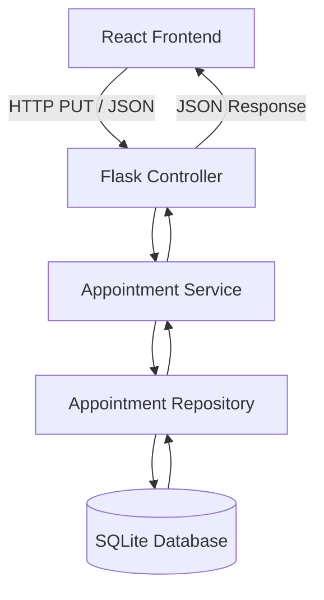

| Thành phần | File | Trách nhiệm |
|---|---|---|
| Frontend | `frontend/src/App.jsx` | Hiển thị các màn hình và gửi yêu cầu API bằng Axios |
| Controller | `src/controllers/appointment_controller.py` | Nhận request, gọi Service và trả JSON/HTTP status |
| Service | `src/services/appointment_service.py` | Kiểm tra dữ liệu đầu vào, kiểm tra đối tượng và điều phối nghiệp vụ |
| Repository | `src/repositories/appointment_repository.py` | Truy vấn và cập nhật dữ liệu thông qua SQLAlchemy |
| Model | `src/models/appointment.py` | Khai báo model `Appointment`, `Technician` và đối tượng `db` |
| Application | `app.py` | Tạo Flask app, cấu hình SQLite và đăng ký Blueprint |

## 5. Chức năng và luồng nghiệp vụ

### 5.1. Phân công kỹ thuật viên

API thực hiện các bước sau:

1. Frontend gửi `appointment_id` trên URL và `technician_id` trong JSON body.
2. Controller nhận request và gọi `AppointmentService.assign_technician()`.
3. Service kiểm tra hai mã ID không được để trống.
4. Service yêu cầu Repository tìm lịch hẹn.
5. Service yêu cầu Repository tìm kỹ thuật viên.
6. Nếu cả hai đối tượng tồn tại, Repository cập nhật `technician_id` và trạng thái lịch hẹn thành `Assigned`.
7. Controller trả dữ liệu lịch hẹn đã cập nhật về Frontend.

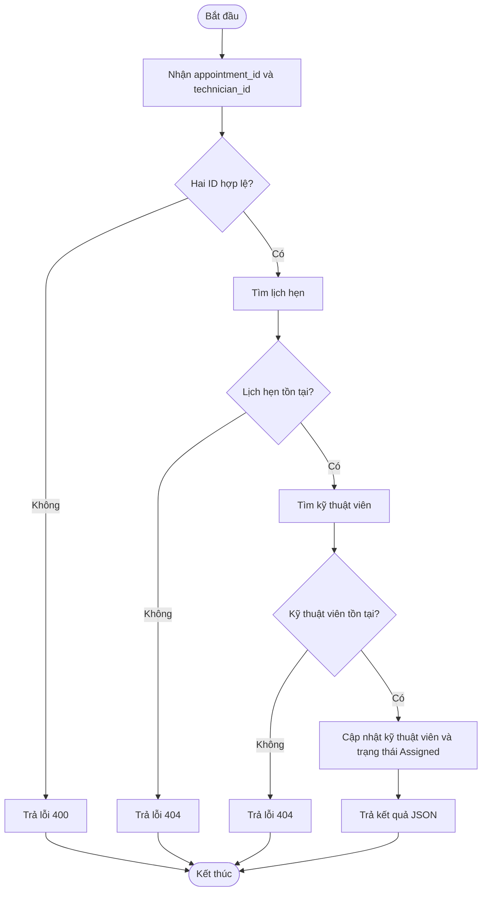

### 5.2. Business Rules đã thể hiện trong code

- `appointment_id` và `technician_id` không được để trống.
- Lịch hẹn phải tồn tại trong database.
- Kỹ thuật viên phải tồn tại trong database.
- Khi cập nhật thành công, lịch hẹn được gán `technician_id` và chuyển sang trạng thái `Assigned`.

**Các điều kiện chưa được triển khai trong Service hiện tại:** kiểm tra trạng thái `Available` của kỹ thuật viên, chuyên môn phù hợp, khu vực/trung tâm, workload, xung đột thời gian và điều kiện chỉ phân công lịch hẹn ở trạng thái `Pending`. Không nên hiểu các trường dữ liệu hoặc nội dung minh họa trên giao diện là những quy tắc đã được Backend xác thực.

## 6. Cấu trúc dữ liệu

Database sử dụng SQLite với hai model được khai báo trong `src/models/appointment.py`.

### 6.1. Bảng `technicians`

| Trường | Kiểu dữ liệu | Mô tả |
|---|---|---|
| `id` | Integer, Primary Key | Mã kỹ thuật viên |
| `name` | String(100), NOT NULL | Họ tên kỹ thuật viên |
| `specialty` | String(100), Nullable | Chuyên môn sửa chữa |
| `status` | String(50), mặc định `Available` | Trạng thái kỹ thuật viên |

Các giá trị trạng thái được ghi chú trong model: `Available`, `Busy`, `Offline`.

### 6.2. Bảng `appointments`

| Trường | Kiểu dữ liệu | Mô tả |
|---|---|---|
| `id` | Integer, Primary Key | Mã lịch hẹn |
| `customer_name` | String(100), NOT NULL | Tên khách hàng |
| `device_info` | String(150), NOT NULL | Thông tin thiết bị |
| `appointment_date` | DateTime, NOT NULL | Ngày giờ hẹn, mặc định UTC hiện tại |
| `status` | String(50), mặc định `Pending` | Trạng thái lịch hẹn |
| `technician_id` | Integer, Foreign Key, Nullable | Kỹ thuật viên được phân công |

Các trạng thái được ghi chú trong model: `Pending`, `Assigned`, `Completed`, `Cancelled`.

### 6.3. Quan hệ dữ liệu

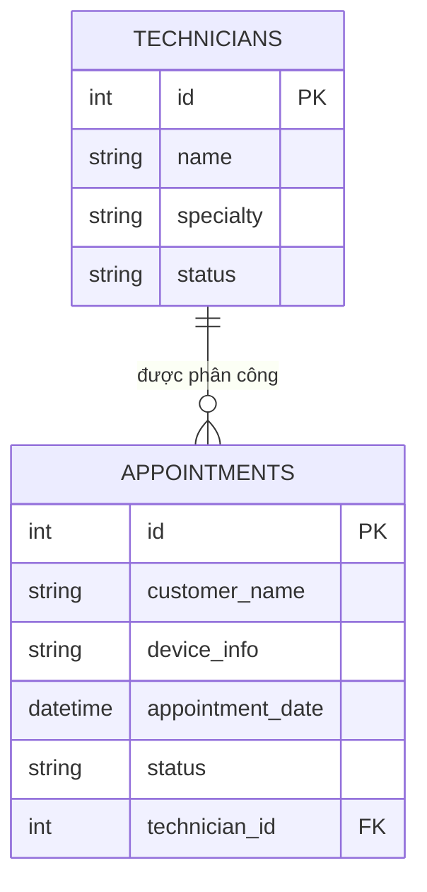

## 7. API Backend

### 7.1. Kiểm tra trạng thái API

| Method | Endpoint | Mô tả |
|---|---|---|
| `GET` | `/` | Kiểm tra Backend đang hoạt động |

### 7.2. Phân công kỹ thuật viên

| Method | Endpoint | Mô tả |
|---|---|---|
| `PUT` | `/api/appointments/{appointment_id}/assign` | Gán kỹ thuật viên cho lịch hẹn |

**Request body**

```json
{
  "technician_id": 1
}
```

**Response thành công – HTTP 200**

```json
{
  "success": true,
  "data": {
    "id": 1,
    "customer_name": "Nguyễn Văn Minh",
    "device_info": "iPhone 14",
    "appointment_date": "2025-09-10 09:00:00",
    "status": "Assigned",
    "technician_id": 1
  }
}
```

**Các mã lỗi được xử lý trong Controller**

| HTTP status | Trường hợp |
|---|---|
| `400` | Thiếu mã lịch hẹn hoặc mã kỹ thuật viên / dữ liệu đầu vào không hợp lệ theo Service |
| `404` | Không tìm thấy lịch hẹn hoặc kỹ thuật viên |
| `500` | Lỗi ngoài dự kiến trong quá trình xử lý |

Chi tiết API được trình bày thêm trong [`docs/api-contract-l4.md`](docs/api-contract-l4.md).

## 8. Cài đặt và chạy dự án

### 8.1. Yêu cầu môi trường

- Python 3.10 trở lên (khuyến nghị dùng phiên bản Python tương thích với các package trong `requirements.txt`).
- Node.js và npm tương thích với Vite 8.
- Git.

Các lệnh dưới đây dùng PowerShell trên Windows. Nếu dùng macOS/Linux, thay lệnh kích hoạt môi trường ảo bằng `source .venv/bin/activate`.

### 8.2. Clone repository

```bash
git clone <GITHUB_REPOSITORY_URL>
cd CDTN1_HHaDaiVi_2374802010551-main
```

Thay `<GITHUB_REPOSITORY_URL>` bằng URL repository GitHub sau khi bạn tạo repository.

### 8.3. Cài đặt Backend

Tạo môi trường ảo:

```powershell
python -m venv .venv
```

Kích hoạt môi trường ảo:

```powershell
.\.venv\Scripts\Activate.ps1
```

Cài đặt thư viện:

```powershell
python -m pip install --upgrade pip
pip install -r requirements.txt
```

### 8.4. Khởi chạy Backend

Tại thư mục gốc dự án:

```powershell
python app.py
```

Backend chạy tại:

```text
http://127.0.0.1:5000
```

Kiểm tra API bằng PowerShell:

```powershell
Invoke-RestMethod -Uri "http://127.0.0.1:5000/" -Method GET
```

Kết quả mong đợi:

```json
{
  "message": "Mekong Mobile Smart CRM API - Module L4 is running!"
}
```

Khi chạy trực tiếp `app.py`, ứng dụng gọi `db.create_all()` để tạo các bảng nếu chưa tồn tại. Database SQLite được Flask đặt trong thư mục `instance/` của ứng dụng. Thư mục này được tạo tự động nếu chưa tồn tại.

### 8.5. Chuẩn bị dữ liệu kiểm thử

Repository không có API tạo lịch hẹn/kỹ thuật viên. Dự án có cung cấp script dữ liệu mẫu `docs/seed.sql` để phục vụ demo. Sau khi chạy Backend lần đầu để tạo bảng, dừng Backend rồi thực thi script:

```powershell
sqlite3 instance/mekong_crm.db ".read docs/seed.sql"
```

Script sử dụng `INSERT OR IGNORE`, vì vậy có thể chạy lại mà không thêm trùng các bản ghi có cùng ID. Nếu máy chưa cài SQLite CLI, bạn có thể mở file `docs/seed.sql` bằng DB Browser for SQLite và chạy nội dung trên database `instance/mekong_crm.db`. Dữ liệu này chỉ phục vụ demo; không đưa database cá nhân chứa dữ liệu thật lên GitHub.

### 8.6. Cài đặt và chạy Frontend

Mở Terminal thứ hai tại thư mục gốc:

```powershell
cd frontend
npm ci
npm run dev
```

Vite hiển thị địa chỉ local, thông thường:

```text
http://localhost:5173
```

Mở địa chỉ này trên trình duyệt. Frontend gửi yêu cầu phân công đến Backend tại `http://127.0.0.1:5000`; vì vậy cần giữ Backend hoạt động trong lúc demo.

### 8.7. Build Frontend

Tại thư mục `frontend`:

```powershell
npm run build
```

Lệnh tạo thư mục `frontend/dist/`. Đây là thư mục build sinh tự động, không cần commit lên GitHub.

## 9. Kiểm thử

### 9.1. Chạy Unit Test

Tại thư mục gốc, kích hoạt môi trường ảo rồi chạy:

```powershell
pytest -v
```

Kết quả được ghi nhận trong `docs/Uni_test.md`:

<pre>
3 passed
</pre>

| Test case | Nội dung | Kết quả ghi nhận |
|---|---|---|
| `test_assign_technician_success` | Phân công thành công | PASSED |
| `test_assign_technician_missing_data` | Thiếu ID đầu vào | PASSED |
| `test_assign_technician_not_found` | Không tìm thấy lịch hẹn | PASSED |

Các bài test hiện tại là **Unit Test cho AppointmentService**, sử dụng `MagicMock` để giả lập Repository. Đây chưa phải bộ Integration Test kiểm tra toàn bộ request HTTP và database thật.

### 9.2. Kiểm thử API thủ công

Ví dụ gửi yêu cầu phân công bằng PowerShell:

```powershell
$body = @{ technician_id = 1 } | ConvertTo-Json

Invoke-RestMethod `
  -Uri "http://127.0.0.1:5000/api/appointments/1/assign" `
  -Method PUT `
  -ContentType "application/json" `
  -Body $body
```

Điều kiện: lịch hẹn ID `1` và kỹ thuật viên ID `1` phải tồn tại trong database.

## 10. Giao diện minh chứng

Các ảnh dưới đây được lưu trong thư mục `docs/` của repository.

### 10.1. Tổng quan giao diện Frontend

| Màn hình | Hình ảnh |
|---|---|
| Điều phối và phân công | 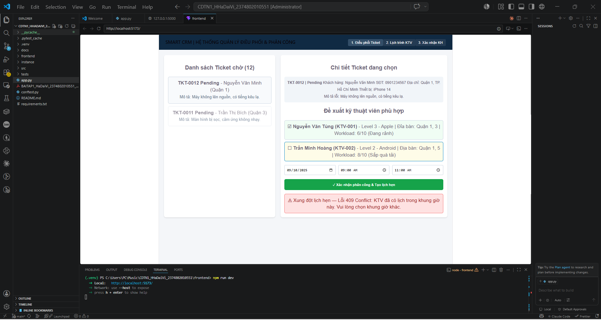 |
| Lịch trình kỹ thuật viên | 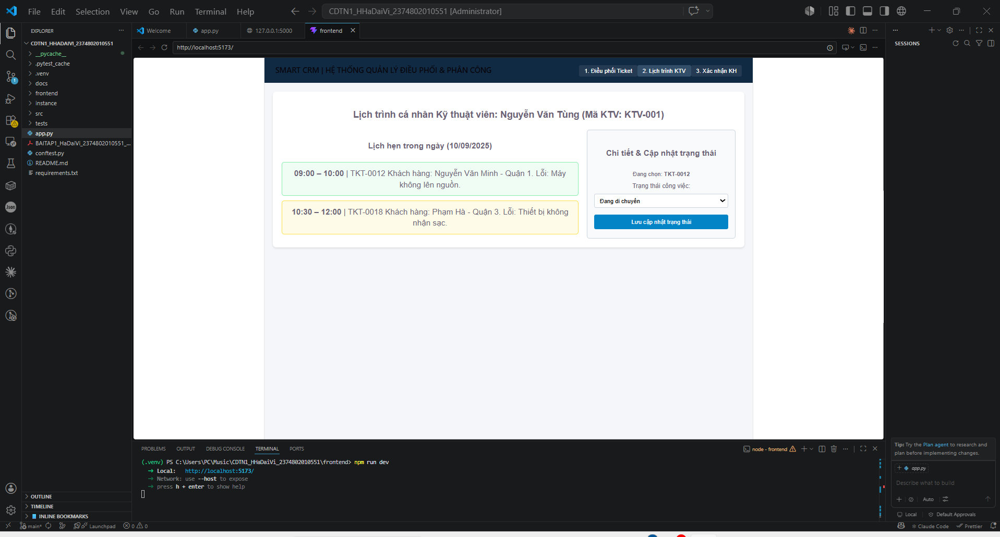 |
| Xác nhận lịch hẹn | 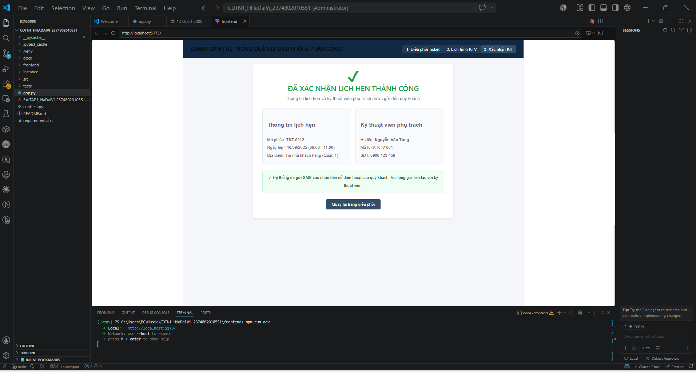 |

### 10.2. Sơ đồ phân tích và thiết kế

**Architecture Diagram**

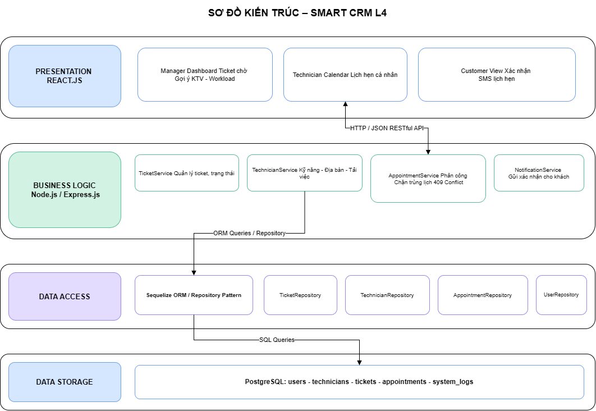

**ERD – Entity Relationship Diagram**

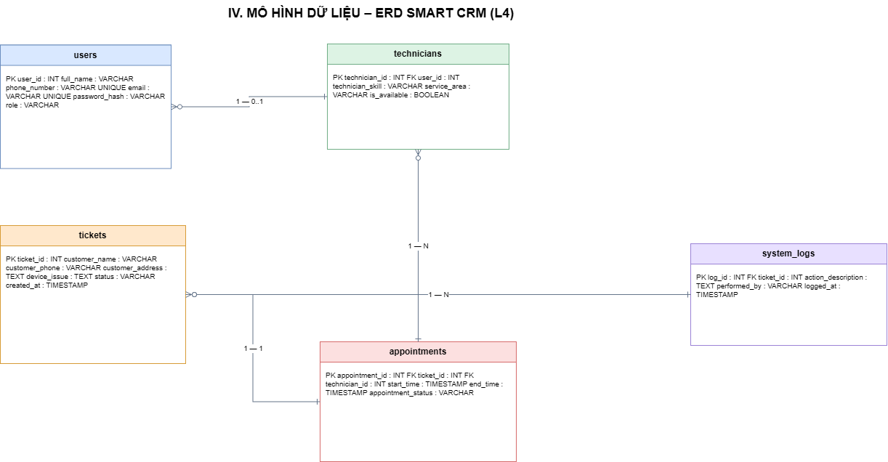

**Backend structure**

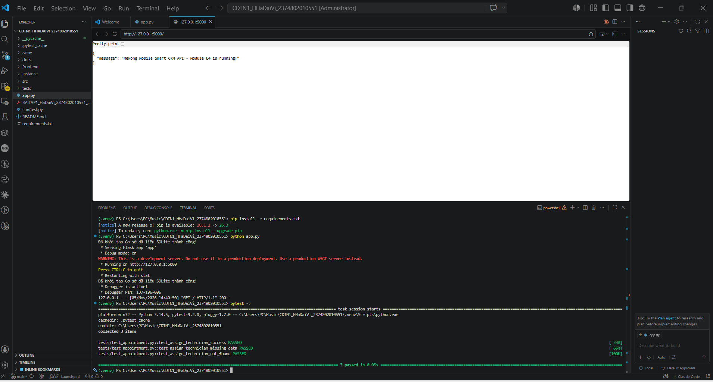

### 10.3. Wireframe

<details>
<summary>Xem các wireframe thiết kế</summary>

**Wireframe 1**

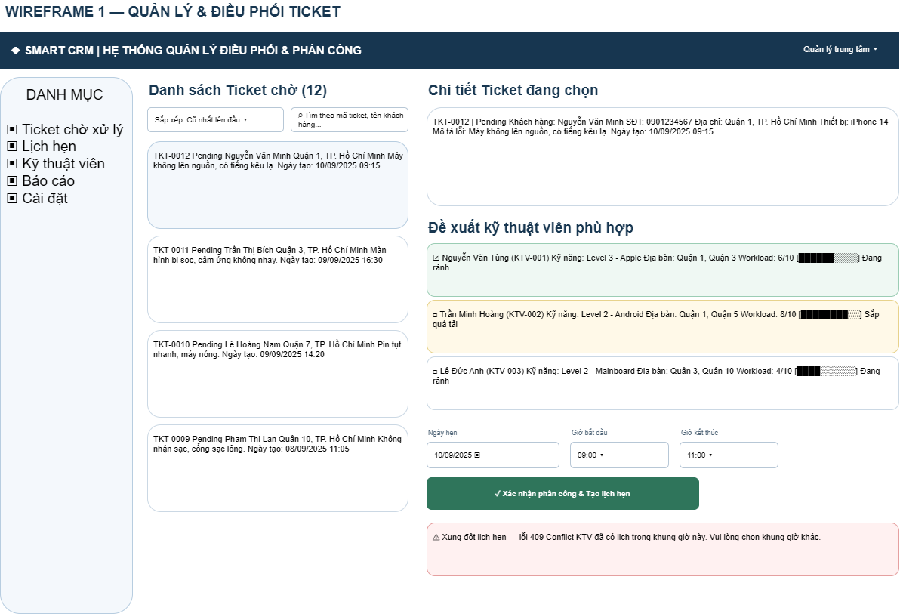

**Wireframe 2**

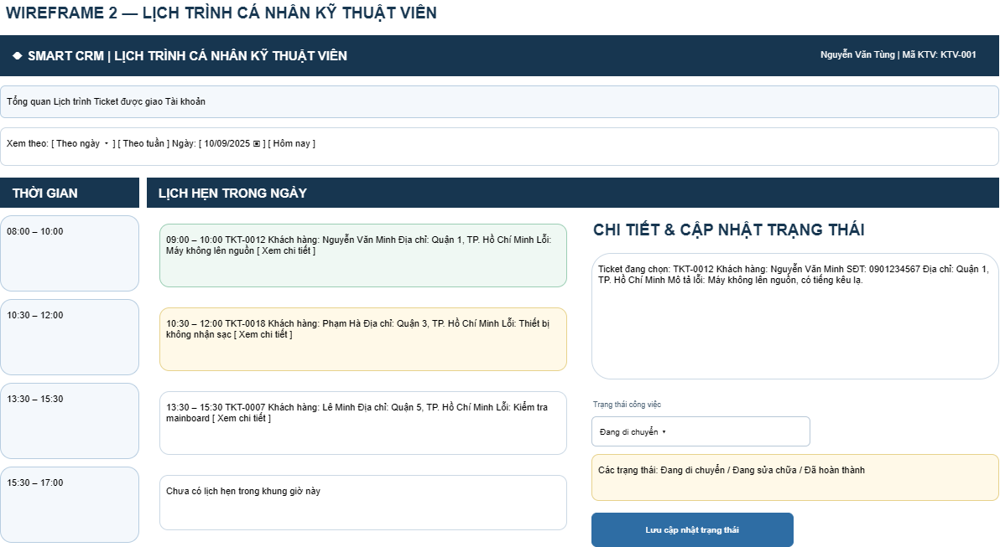

**Wireframe 3**

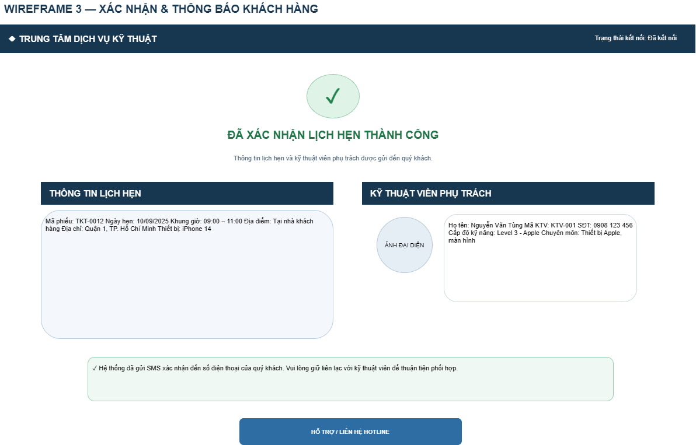

</details>

## 11. Cấu trúc thư mục

```text
CDTN1_HHaDaiVi_2374802010551-main/
├── app.py
├── requirements.txt
├── README.md
├── conftest.py
├── src/
│   ├── controllers/
│   │   └── appointment_controller.py
│   ├── models/
│   │   └── appointment.py
│   ├── repositories/
│   │   └── appointment_repository.py
│   └── services/
│       └── appointment_service.py
├── frontend/
│   ├── public/
│   ├── src/
│   │   ├── assets/
│   │   ├── App.jsx
│   │   ├── App.css
│   │   ├── index.css
│   │   └── main.jsx
│   ├── package.json
│   ├── package-lock.json
│   └── vite.config.js
├── tests/
│   └── test_appointment.py
└── docs/
    ├── Architecture_L4.png
    ├── Backend.png
    ├── ERD_L4.png
    ├── Wireframes_L4_1.png
    ├── Wireframes_L4_2.png
    ├── Wireframes_L4_3.png
    ├── frontend1.png
    ├── frontend2.png
    ├── frontend3.png
    ├── api-contract-l4.md
    ├── seed.sql
    ├── backend.md
    ├── frontend.md
    ├── buglog.md
    └── Uni_test.md
```

## 12. Giới hạn và hướng phát triển

### 12.1. Giới hạn hiện tại

- Backend mới có endpoint kiểm tra trạng thái API và endpoint phân công lịch hẹn.
- Chưa có API CRUD cho Appointment và Technician.
- Chưa có API lấy danh sách lịch hẹn hoặc danh sách kỹ thuật viên.
- Chưa kiểm tra trạng thái khả dụng, chuyên môn, khu vực và workload của kỹ thuật viên khi phân công.
- Chưa có logic phát hiện xung đột lịch hẹn.
- Frontend đang hiển thị một số dữ liệu mẫu cố định; màn hình lịch trình và xác nhận chưa được kết nối đầy đủ với Backend.
- Chưa tích hợp gửi SMS hoặc thông báo thực tế.
- Bộ test hiện tại gồm 3 Unit Test cho Service, chưa bao phủ toàn bộ API và giao diện.

### 12.2. Hướng phát triển

- Bổ sung API CRUD và truy vấn lịch hẹn/kỹ thuật viên.
- Hoàn thiện Business Rules về trạng thái, chuyên môn, khu vực và workload.
- Xây dựng cơ chế kiểm tra trùng lịch theo khoảng thời gian.
- Kết nối dữ liệu động giữa Frontend và Backend cho các màn hình.
- Bổ sung xác thực, phân quyền và ghi nhận lịch sử thay đổi phân công.
- Mở rộng Unit Test, Integration Test và kiểm thử giao diện.

## 13. Tài liệu tham khảo trong dự án

| Tài liệu | Nội dung |
|---|---|
| [`BAITAP1_HaDaiVi_2374802010551_Track SE_LuồngL4.pdf`](<BAITAP1_HaDaiVi_2374802010551_Track SE_LuồngL4.pdf>) | Tài liệu bài tập/thiết kế BT1 |
| [`docs/api-contract-l4.md`](docs/api-contract-l4.md) | Đặc tả API và dữ liệu trao đổi |
| [`docs/Uni_test.md`](docs/Uni_test.md) | Kết quả Unit Test được ghi nhận |
| [`docs/buglog.md`](docs/buglog.md) | Nhật ký lỗi |
| [`docs/backend.md`](docs/backend.md) | Ghi chú chạy Backend và log kiểm tra |
| [`docs/frontend.md`](docs/frontend.md) | Ghi chú chạy Frontend |

---

