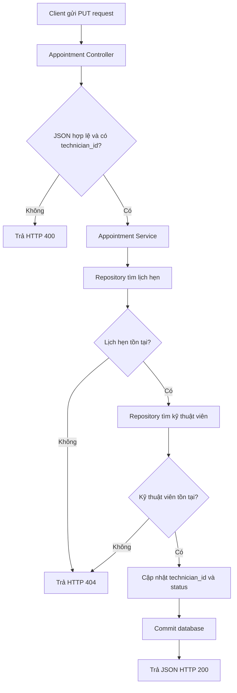

<div align="center">

# SMART CRM – MEKONG MOBILE

### API CONTRACT · LUỒNG NGHIỆP VỤ L4

**Phân công kỹ thuật viên & quản lý lịch hẹn**

<br>

| **Sinh viên** | **MSSV** | **Track** |
|:---:|:---:|:---:|
| Hà Đại Vĩ | `2374802010551` | Software Engineering |

<br>


</div>

---

> [!IMPORTANT]
> **Phạm vi tài liệu:** Tài liệu này ghi nhận API phân công kỹ thuật viên dựa trên các đoạn mã đã được cung cấp và trao đổi. Không xem các endpoint minh họa hoặc chức năng chưa được xác minh là đã triển khai. Kết quả kiểm thử phải được cập nhật từ lần chạy thực tế.

## 📑 Mục lục

- [1. Tổng quan](#1-tổng-quan)
- [2. Phạm vi triển khai đã xác nhận](#2-phạm-vi-triển-khai-đã-xác-nhận)
- [3. API phân công kỹ thuật viên](#3-api-phân-công-kỹ-thuật-viên)
  - [3.1. Endpoint](#31-endpoint)
  - [3.2. Request](#32-request)
  - [3.3. Response](#33-response)
  - [3.4. Mã lỗi](#34-mã-lỗi)
- [4. Quy trình xử lý](#4-quy-trình-xử-lý)
- [5. Kiến trúc phân lớp](#5-kiến-trúc-phân-lớp)
- [6. Quy tắc nghiệp vụ](#6-quy-tắc-nghiệp-vụ)
- [7. Hướng dẫn chạy và kiểm thử](#7-hướng-dẫn-chạy-và-kiểm-thử)
- [8. Các vấn đề gặp trong quá trình kiểm thử](#8-các-vấn-đề-gặp-trong-quá-trình-kiểm-thử)
- [9. Giới hạn và hướng phát triển](#9-giới-hạn-và-hướng-phát-triển)
- [10. Tài liệu liên quan](#10-tài-liệu-liên-quan)

---

## 1. Tổng quan

Luồng nghiệp vụ **L4 – Phân công kỹ thuật viên và lịch hẹn** thuộc hệ thống Smart CRM – Mekong Mobile. Phần API được trao đổi trong tài liệu này tập trung vào việc gán kỹ thuật viên cho một lịch hẹn và cập nhật trạng thái lịch hẹn.

### Công nghệ sử dụng

| Thành phần | Công nghệ / thư viện |
|---|---|
| Ngôn ngữ | Python |
| Backend framework | Flask |
| ORM | SQLAlchemy |
| Cơ sở dữ liệu phát triển | SQLite |
| Kiến trúc | Controller – Service – Repository – Model |
| Công cụ kiểm thử | PowerShell, `Invoke-RestMethod` |

## 2. Phạm vi triển khai đã xác nhận

Dựa trên các đoạn mã đã được cung cấp trong quá trình làm việc:

| Thành phần | Trách nhiệm | Tình trạng |
|---|---|:---:|
| `appointment_controller.py` | Nhận request phân công và trả JSON response | Có đoạn mã |
| `appointment_service.py` | Kiểm tra dữ liệu, lịch hẹn, kỹ thuật viên và gọi Repository | Có đoạn mã |
| `appointment_repository.py` | Truy vấn lịch hẹn/kỹ thuật viên và cập nhật dữ liệu | Có đoạn mã |
| `appointment.py` | Khai báo model `Appointment`, `Technician` và `db` | Chưa rà soát đầy đủ |

> [!NOTE]
> Bảng này phản ánh các đoạn mã đã được chia sẻ trong cuộc trao đổi, không phải kết quả kiểm tra tự động toàn bộ repository. Cần đối chiếu source code hiện tại trước khi nộp báo cáo.

## 3. API phân công kỹ thuật viên

### 3.1. Endpoint

<div align="center">

| Thuộc tính | Giá trị |
|:---|:---|
| **HTTP Method** | `PUT` |
| **Endpoint** | `/api/appointments/{appointment_id}/assign` |
| **Content-Type** | `application/json` |
| **Chức năng** | Phân công kỹ thuật viên cho lịch hẹn |

</div>

**Mô tả:** API tiếp nhận mã lịch hẹn trên URL và mã kỹ thuật viên trong request body. Sau khi kiểm tra dữ liệu, hệ thống cập nhật kỹ thuật viên phụ trách và trạng thái lịch hẹn thành `Assigned`.

### 3.2. Request

**Path parameter**

| Tên | Kiểu dữ liệu | Bắt buộc | Mô tả |
|---|---|:---:|---|
| `appointment_id` | Integer | Có | ID lịch hẹn cần phân công |

**Request body**

```http
PUT /api/appointments/1/assign
Content-Type: application/json
```

```json
{
  "technician_id": 1
}
```

| Trường | Kiểu dữ liệu | Bắt buộc | Mô tả |
|---|---|:---:|---|
| `technician_id` | Integer | Có | ID kỹ thuật viên được phân công |

### 3.3. Response

<details>
<summary><strong>200 OK</strong> — Phân công thành công (response minh họa)</summary>

```json
{
  "success": true,
  "data": {
    "appointment_id": 1,
    "technician_id": 1,
    "status": "Assigned"
  }
}
```

Các trường trong `data` phụ thuộc vào phương thức `Appointment.to_dict()` thực tế của project.

</details>

<details>
<summary><strong>400 Bad Request</strong> — Dữ liệu đầu vào không hợp lệ</summary>

```json
{
  "success": false,
  "error": "Thiếu mã kỹ thuật viên."
}
```

</details>

<details>
<summary><strong>404 Not Found</strong> — Không tìm thấy dữ liệu</summary>

```json
{
  "success": false,
  "error": "Không tìm thấy lịch hẹn."
}
```

Thông báo cụ thể phụ thuộc vào việc không tìm thấy lịch hẹn hay kỹ thuật viên.

</details>

<details>
<summary><strong>500 Internal Server Error</strong> — Lỗi hệ thống</summary>

```json
{
  "success": false,
  "error": "Lỗi hệ thống nội bộ."
}
```

</details>

> [!WARNING]
> Các JSON response ở trên mô tả cấu trúc phản hồi dự kiến theo Controller đã trao đổi. Chỉ sử dụng làm kết quả thực tế trong báo cáo sau khi chạy API và xác nhận output.

### 3.4. Mã lỗi HTTP

| HTTP status | Ý nghĩa | Điều kiện |
|:---:|---|---|
| `200` | OK | Cập nhật phân công thành công |
| `400` | Bad Request | JSON không hợp lệ hoặc thiếu mã kỹ thuật viên |
| `404` | Not Found | Không tìm thấy lịch hẹn hoặc kỹ thuật viên |
| `500` | Internal Server Error | Lỗi ngoài dự kiến trong quá trình xử lý |

## 4. Quy trình xử lý



## 5. Kiến trúc phân lớp

Luồng xử lý được tách thành các lớp để phân chia trách nhiệm và hỗ trợ bảo trì.

| Lớp | File / thành phần | Trách nhiệm |
|---|---|---|
| Controller | `appointment_controller.py` | Nhận HTTP request, gọi Service, tạo JSON response |
| Service | `appointment_service.py` | Kiểm tra dữ liệu và điều phối nghiệp vụ |
| Repository | `appointment_repository.py` | Truy vấn, cập nhật dữ liệu qua SQLAlchemy |
| Model | `src/models/appointment.py` | Đại diện dữ liệu `Appointment`, `Technician` và database |

### 5.1. Controller

Blueprint được khai báo:

```python
appointment_bp = Blueprint('appointment', __name__)
```

Route phân công:

```python
@appointment_bp.route(
    '/api/appointments/<int:appointment_id>/assign',
    methods=['PUT']
)
def assign_appointment(appointment_id):
    ...
```

Controller tiếp nhận `appointment_id`, đọc `technician_id` từ JSON, gọi Service và trả kết quả theo mã HTTP.

### 5.2. Service

`AppointmentService` thực hiện các bước:

1. Kiểm tra `appointment_id` và `technician_id` không bị thiếu.
2. Gọi `find_by_id()` để kiểm tra lịch hẹn.
3. Gọi `find_technician_by_id()` để kiểm tra kỹ thuật viên.
4. Gọi `update_technician()` để cập nhật phân công.
5. Trả dữ liệu sau cập nhật cho Controller.

### 5.3. Repository

Các phương thức đã được chia sẻ:

| Phương thức | Chức năng |
|---|---|
| `find_by_id(appointment_id)` | Tìm lịch hẹn theo ID |
| `find_technician_by_id(technician_id)` | Tìm kỹ thuật viên theo ID |
| `update_technician(appointment_id, technician_id, status)` | Cập nhật kỹ thuật viên và trạng thái lịch hẹn |

Đoạn cập nhật dữ liệu:

```python
appointment.technician_id = technician_id
appointment.status = status

db.session.commit()

return appointment.to_dict()
```

## 6. Quy tắc nghiệp vụ

| Mã | Quy tắc |
|---|---|
| BR1 | Mã lịch hẹn và mã kỹ thuật viên không được để trống. |
| BR2 | Lịch hẹn phải tồn tại trước khi cập nhật phân công. |
| BR3 | Kỹ thuật viên phải tồn tại trước khi cập nhật phân công. |
| BR4 | Khi cập nhật thành công, `technician_id` được gán cho lịch hẹn. |
| BR5 | Trạng thái lịch hẹn được cập nhật thành `Assigned`. |
| BR6 | Thay đổi phải được commit vào cơ sở dữ liệu. |

> [!IMPORTANT]
> Trong các đoạn code đã trao đổi, chưa có đủ căn cứ để xác nhận các điều kiện nâng cao như kỹ thuật viên `AVAILABLE`, cùng trung tâm, proficiency, giới hạn workload hoặc kiểm tra trùng lịch. Không mô tả các điều kiện này là đã triển khai nếu chưa kiểm tra source code.

## 7. Hướng dẫn chạy và kiểm thử

### 7.1. Chuẩn bị môi trường

Mở Terminal tại thư mục gốc của repository.

Kích hoạt môi trường ảo:

```powershell
.\.venv\Scripts\Activate.ps1
```

Nếu môi trường ảo chưa được tạo:

```powershell
python -m venv .venv
.\.venv\Scripts\Activate.ps1
```

Cài đặt thư viện:

```powershell
pip install -r requirements.txt
```

### 7.2. Khởi động Backend

Tại **Terminal 1**:

```powershell
python app.py
```

Khi Flask khởi động thành công, Terminal hiển thị địa chỉ tương tự:

```text
Running on http://127.0.0.1:5000
```

Giữ Terminal này hoạt động trong suốt quá trình kiểm thử.

### 7.3. Kiểm thử phân công thành công

Mở **Terminal 2** và gửi request:

```powershell
$body = @{ technician_id = 1 } | ConvertTo-Json

Invoke-RestMethod `
    -Uri "http://127.0.0.1:5000/api/appointments/1/assign" `
    -Method PUT `
    -ContentType "application/json" `
    -Body $body
```

**Kết quả mong đợi:** Khi lịch hẹn ID `1` và kỹ thuật viên ID `1` tồn tại, thao tác cập nhật thành công và API trả về `success: true`.

### 7.4. Kiểm thử thiếu mã kỹ thuật viên

```powershell
$body = @{} | ConvertTo-Json

Invoke-RestMethod `
    -Uri "http://127.0.0.1:5000/api/appointments/1/assign" `
    -Method PUT `
    -ContentType "application/json" `
    -Body $body
```

**Kết quả mong đợi:** HTTP `400 Bad Request` nếu Controller có kiểm tra thiếu `technician_id` trước khi gọi Service.

### 7.5. Kiểm thử lịch hẹn không tồn tại

```powershell
$body = @{ technician_id = 1 } | ConvertTo-Json

Invoke-RestMethod `
    -Uri "http://127.0.0.1:5000/api/appointments/9999/assign" `
    -Method PUT `
    -ContentType "application/json" `
    -Body $body
```

**Kết quả mong đợi:** HTTP `404 Not Found` nếu lịch hẹn ID `9999` không tồn tại và Controller ánh xạ `LookupError` thành HTTP 404.

### 7.6. Kiểm thử kỹ thuật viên không tồn tại

```powershell
$body = @{ technician_id = 9999 } | ConvertTo-Json

Invoke-RestMethod `
    -Uri "http://127.0.0.1:5000/api/appointments/1/assign" `
    -Method PUT `
    -ContentType "application/json" `
    -Body $body
```

**Kết quả mong đợi:** HTTP `404 Not Found` nếu lịch hẹn ID `1` tồn tại nhưng kỹ thuật viên ID `9999` không tồn tại.

### 7.7. Bảng test case

| Test case | Dữ liệu kiểm thử | Kết quả mong đợi |
|---|---|:---:|
| TC01 | Lịch hẹn và kỹ thuật viên tồn tại | `200` |
| TC02 | Thiếu `technician_id` | `400` |
| TC03 | Lịch hẹn không tồn tại | `404` |
| TC04 | Kỹ thuật viên không tồn tại | `404` |
| TC05 | JSON sai định dạng | `400` |

> [!TIP]
> `Invoke-RestMethod` có thể hiển thị HTTP error dưới dạng lỗi PowerShell thay vì output thông thường. Khi cần lưu mã trạng thái và response body để làm minh chứng, hãy bắt lỗi bằng `try/catch` và đọc thông tin từ `Exception.Response`.

**Mẫu ghi nhận kết quả thực tế**

| Test case | HTTP thực tế | Pass/Fail | Ảnh minh chứng |
|---|---|---|---|
| TC01 | Chưa ghi nhận | Chưa kiểm thử | Bổ sung sau |
| TC02 | Chưa ghi nhận | Chưa kiểm thử | Bổ sung sau |
| TC03 | Chưa ghi nhận | Chưa kiểm thử | Bổ sung sau |
| TC04 | Chưa ghi nhận | Chưa kiểm thử | Bổ sung sau |
| TC05 | Chưa ghi nhận | Chưa kiểm thử | Bổ sung sau |

## 8. Các vấn đề gặp trong quá trình kiểm thử

### 8.1. Không kết nối được tới cổng API

Ví dụ:

```text
curl: (7) Failed to connect to 127.0.0.1 port 5173
```

**Nguyên nhân:** Request được gửi tới cổng không có Backend đang lắng nghe hoặc Flask chưa được khởi động.

**Cách xử lý:** Kiểm tra URL và cổng Flask hiển thị trong Terminal. Trong lần chạy đã trao đổi, Flask hiển thị `127.0.0.1:5000`; cổng `5173` thường được dùng cho frontend Vite, không phải API Flask trong cấu hình này.

### 8.2. Endpoint không tồn tại

Ví dụ:

```text
HTTP/1.1 404 NOT FOUND
```

Khi gọi `GET /appointments`, Flask trả về 404 vì chưa có bằng chứng route GET này được khai báo. Việc Flask khởi động thành công không đồng nghĩa mọi URL đều tồn tại.

### 8.3. JSON không đúng định dạng

Ví dụ:

```text
Failed to decode JSON object
```

**Nguyên nhân:** Request body không được truyền dưới dạng JSON hợp lệ.

**Cách xử lý:** Tạo JSON bằng `ConvertTo-Json` và gửi với `Content-Type: application/json` thông qua `Invoke-RestMethod`.

### 8.4. Không tìm thấy lịch hẹn

Ví dụ:

```json
{
  "success": false,
  "error": "Không tìm thấy lịch hẹn."
}
```

**Nguyên nhân có thể:** ID lịch hẹn không tồn tại trong database mà ứng dụng đang kết nối.

**Cách xử lý:** Kiểm tra dữ liệu SQLite và cấu hình database. Đây là lỗi dữ liệu nghiệp vụ, không có nghĩa Flask không hoạt động.

## 9. Giới hạn và hướng phát triển

Các nội dung cần tiếp tục xác minh hoặc phát triển:

- Kiểm tra đầy đủ model `Appointment` và `Technician`.
- Xác nhận cấu hình database mà Flask đang sử dụng.
- Bổ sung hoặc xác minh điều kiện kỹ thuật viên khả dụng.
- Bổ sung hoặc xác minh điều kiện cùng trung tâm và proficiency.
- Kiểm tra giới hạn phân công đang hoạt động.
- Bổ sung kiểm tra trùng lịch hẹn.
- Phát triển chức năng thay đổi kỹ thuật viên và lưu lý do.
- Bổ sung các API xem danh sách công việc và lịch hẹn của kỹ thuật viên.
- Hoàn thiện Unit Test và Integration Test.

Các chức năng chưa có bằng chứng trong mã nguồn không được ghi nhận là đã hoàn thành.

## 10. Tài liệu liên quan

| Tài liệu | Nội dung |
|---|---|
| `app.py` | Khởi tạo ứng dụng Flask và đăng ký Blueprint |
| `src/controllers/` | Các API Controller |
| `src/services/appointment_service.py` | Logic phân công lịch hẹn |
| `src/repositories/appointment_repository.py` | Truy vấn và cập nhật dữ liệu |
| `src/models/appointment.py` | Model Appointment, Technician và database |
| `requirements.txt` | Danh sách thư viện Python |
| `tests/` | Các bài kiểm thử của hệ thống |

---

<div align="center">

**SMART CRM – MEKONG MOBILE**

*Tài liệu API Contract · Luồng nghiệp vụ L4*

</div>
